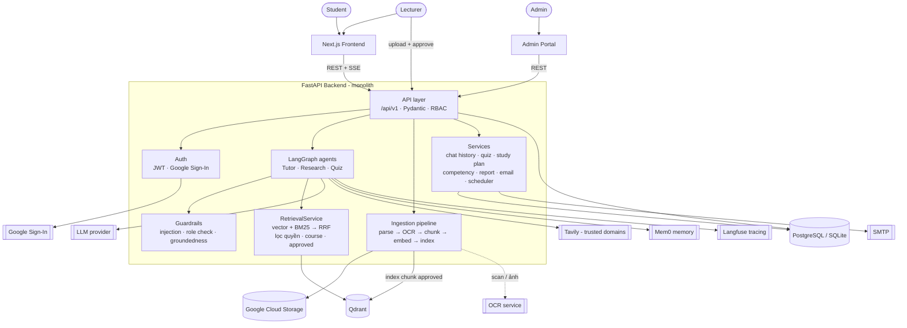
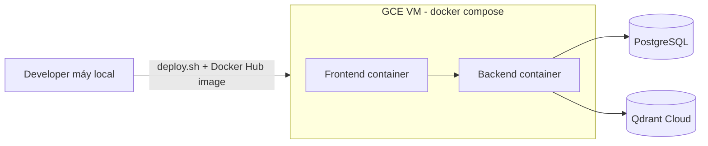

# Lina — Trợ lý học thuật AI

Lina là nền tảng hỗ trợ học tập và nghiên cứu. Student có thể hỏi đáp kiến thức,
tìm và tổng hợp tài liệu có Citation, tạo Quiz để tự luyện và lưu Study plan.
Lecturer kiểm soát tài liệu nào được đưa vào Knowledge base thông qua quy trình
Approval.

Nguyên tắc cốt lõi: **câu trả lời phải truy nguyên được về tài liệu đã được duyệt.**

## Tính năng chính

- **Tutor** — trả lời dựa trên Knowledge base. Với bài tập có tính điểm, chuyển
  sang guide mode: hướng dẫn từng bước kèm Citation, không đưa đáp số.
- **Research** — lập kế hoạch tìm kiếm, tổng hợp tài liệu trong Hub và các nguồn
  web nằm trong whitelist; kết quả luôn có Citation hoặc URL gốc.
- **Quiz** — tạo bộ câu hỏi tự luyện từ Document Student chọn, kèm đáp án, giải
  thích và Citation.
- **Lecturer workflow** — upload Document, kiểm tra chất lượng và Approval. Chỉ
  Document đã `approved` mới được dùng cho tìm kiếm và trả lời.

## Tech stack

| Lớp | Công nghệ |
|---|---|
| Frontend | Next.js 15 (App Router), React 19, TypeScript, Tailwind CSS |
| Backend API | Python 3.11+, FastAPI, Uvicorn, Pydantic, SSE (sse-starlette) |
| AI / Agents | LangGraph, LangChain, OpenAI-compatible LLM provider, Mem0 (memory layer) |
| Retrieval | Qdrant (vector search), BM25 (rank-bm25), Reciprocal Rank Fusion |
| Ingestion | PyMuPDF, python-pptx, python-docx, markitdown, Google Cloud Storage |
| Web search | Tavily (chỉ trusted domains) |
| Database | SQLAlchemy 2.x, Alembic; SQLite (dev), PostgreSQL (production) |
| Auth | JWT, RBAC (Student / Lecturer), Google Sign-In |
| Observability | Langfuse tracing, structured JSON logs, `request_id` |
| Testing | pytest, Ruff; Vitest, Playwright, ESLint, TypeScript |
| Deployment | Docker / Docker Compose; frontend và backend trên Google Compute Engine VM |

## Thiết kế hệ thống (high level)

### Kiến trúc tổng quan

#### Sơ đồ tổng quan

Một FastAPI monolith phục vụ API và agent pipeline. Frontend giao tiếp qua REST và
SSE để stream token; Admin Portal là Next.js app riêng gọi cùng API.

### Các thành phần

| Thành phần | Trách nhiệm |
|---|---|
| Frontend | Giao diện Student và Lecturer; điều hướng qua typed route builders |
| API layer | Route `/api/v1`, validate input bằng Pydantic, kiểm tra JWT và RBAC |
| Agent layer | LangGraph state machine cho Tutor, Research, Quiz; có guardrail deterministic |
| RetrievalService | Hybrid search (vector + BM25) kết hợp RRF; lọc theo quyền, course và `approved` |
| Ingestion | Parse → chunk → embed → index; chỉ Document được Lecturer duyệt mới được publish |
| Data layer | SQL cho user, course, session, quiz, study plan; Qdrant cho vector index |

### Luồng xử lý chính

1. Frontend gửi request kèm JWT.
2. API route validate input và xác thực quyền.
3. Agent chạy pipeline LangGraph: retrieve Chunk đã approved → guardrail → LLM generate.
4. Output được kiểm tra groundedness; Citation metadata đi theo từ Chunk tới response.
5. Response (hoặc stream token qua SSE) trả về Frontend; trace gửi tới Langfuse.

### Luồng ingestion (Lecturer)

1. Lecturer upload Document → lưu vào object storage.
2. Pipeline parse và chunk, sinh embedding, ghi vào Qdrant và BM25 index.
3. Document ở trạng thái chờ cho tới khi Lecturer approve.
4. Chỉ Chunk của Document `approved` mới xuất hiện trong kết quả retrieval.

### Deployment

### Bảo mật và an toàn

- Secret chỉ đọc từ environment variables; không commit `.env`.
- Input validation bằng Pydantic; rate limiting và CORS cấu hình theo domain frontend.
- Research chỉ nhận nguồn từ `TRUSTED_DOMAINS`.
- Tutor có guardrail chống prompt injection, role confusion và tự động chuyển guide mode.
- Retrieval luôn lọc theo quyền, course và trạng thái `approved` ở backend.

## Lưu ý

Source code của project không được công khai theo văn bản bảo mật của chương trình AI20K.

